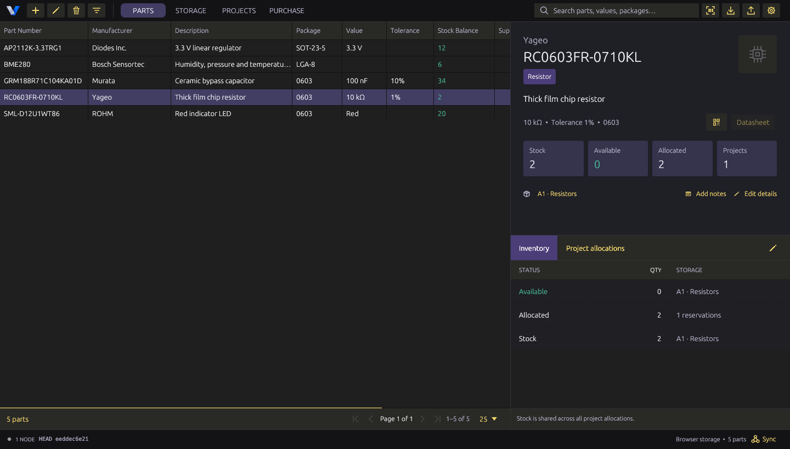
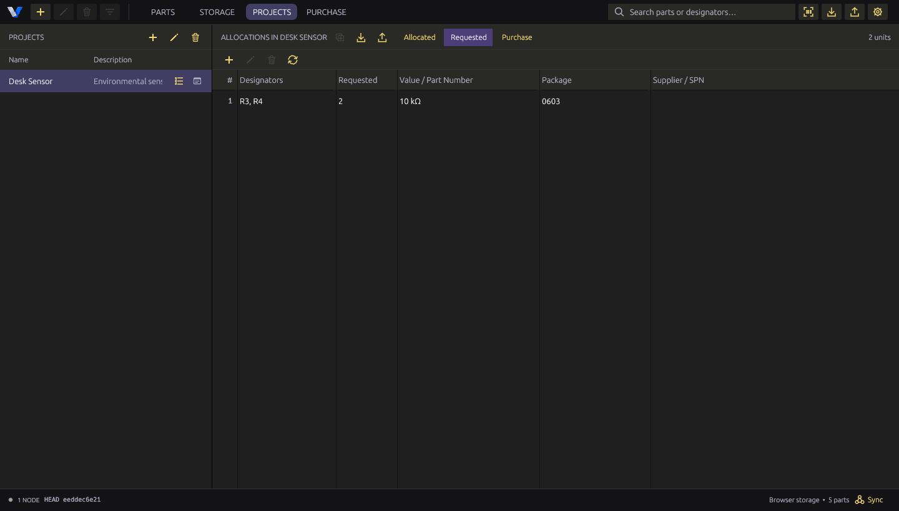
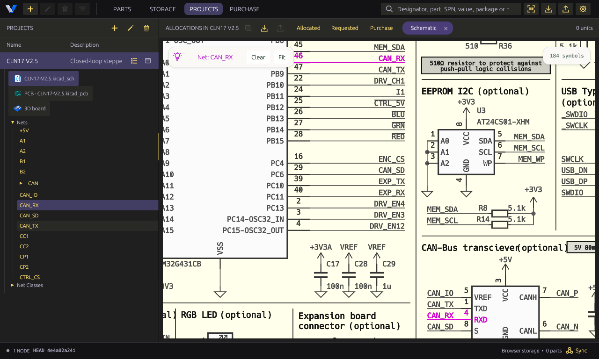
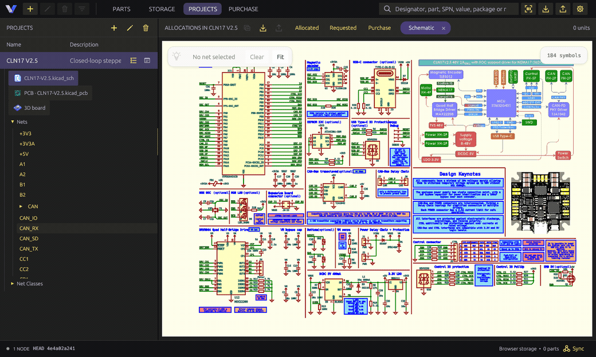
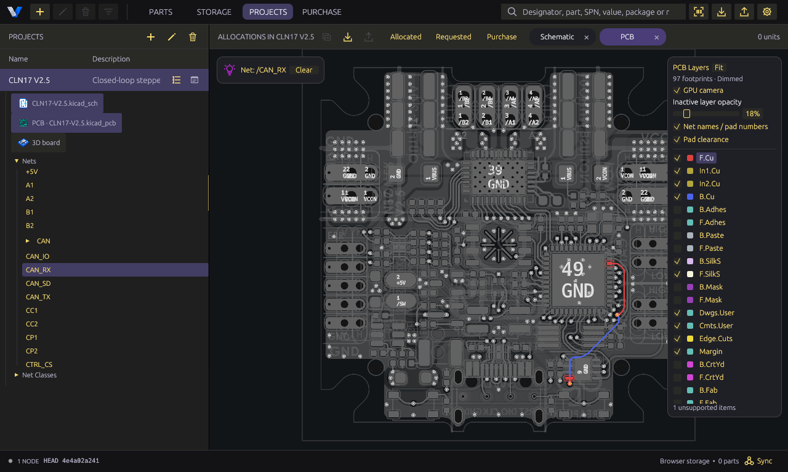
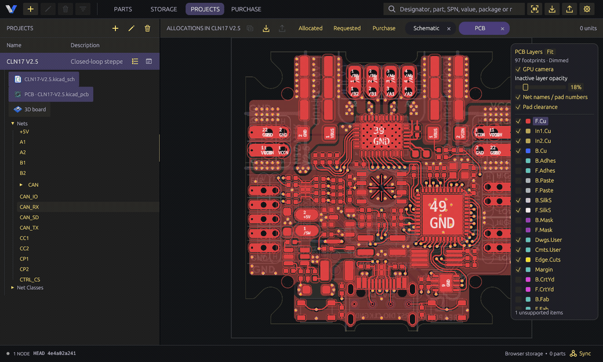
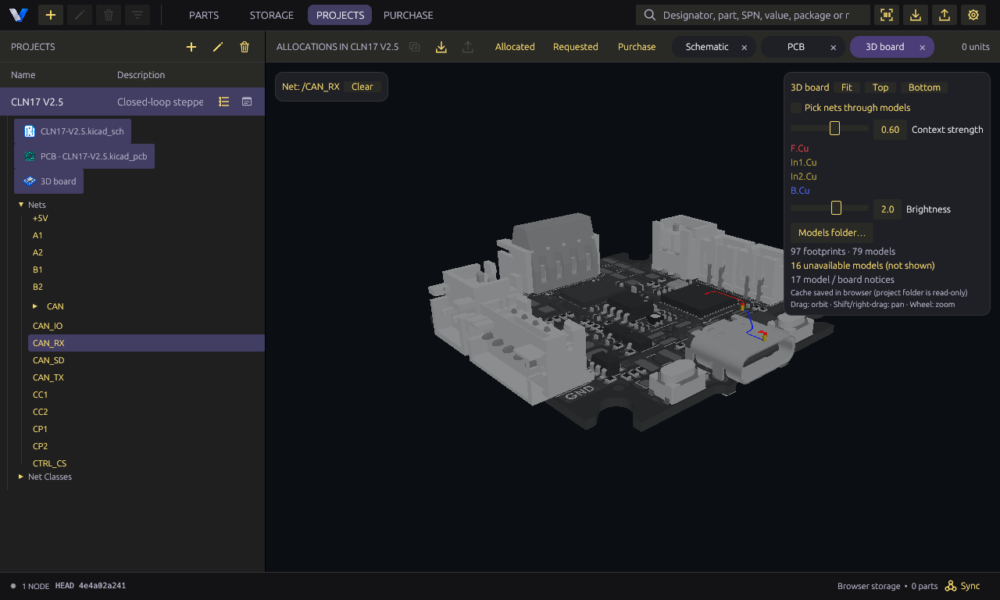
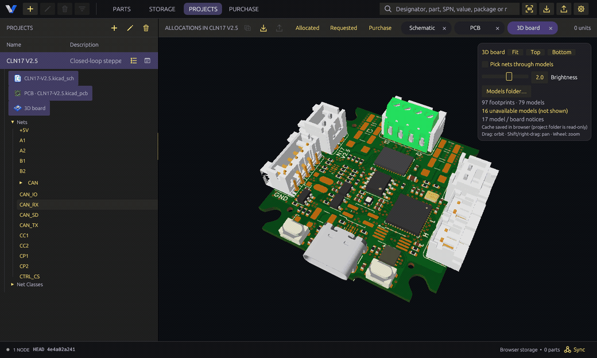
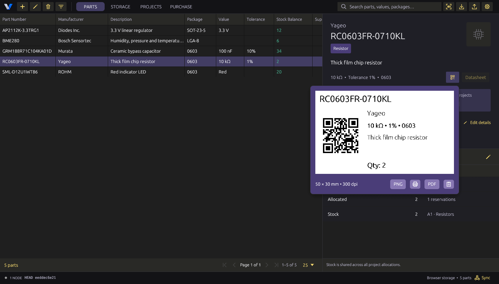

# ViSpace

[Get started](#get-started) · [Check a KiCad BOM](#check-a-kicad-bom-against-your-stock) · [Explore the KiCad views](#find-the-part-on-your-board) · [Order and receive parts](#order-and-receive-parts) · [Sync across devices](#sync-across-devices) · [Technical README](README.md)



*The Parts view with sample inventory. Both resistors in drawer A1 are reserved, so the available quantity is zero.*

## Get started

**On macOS**, open a terminal in your copy of this repository. With Rust installed, run the following command to build and open ViSpace.

```sh
./script/build_and_run.sh --release
```

There’s also a **browser preview** you can build and run locally. It keeps its own inventory, so you can use it on its own or connect it to a desktop instance through **Sync**. See the [browser setup instructions](README.md#browser--webassembly-preview) or the [desktop build instructions](README.md#run).

Start with one drawer and one board. In **Storage**, add a location such as `A1 · Resistors`. In **Parts**, click **+**, enter a part number and the quantity you physically have, then assign it to that location. Add the value, package, and tolerance so you can distinguish similar parts later. You can also attach a photo or datasheet and add searchable labels.

**Already have a spreadsheet?** Use **Import parts from CSV** in **Parts**. Review the quantities in the preview, edit any cells that need correcting, and uncheck rows you want to skip. Matching rows add to existing stock, so review the quantities carefully if you’re importing into a populated inventory.

## Check a KiCad BOM against your stock

1. Open **Projects** and create a project.
2. **With KiCad project files:** Use the folder button to choose the `.kicad_pro` file on desktop, or select the project folder in a supported browser. ViSpace can read the schematic and fill **Requested** with the parts it finds. In **Requested**, click **Review matches with available inventory**.
3. **With a BOM CSV:** Use **Import project BOM** in the project toolbar. The CSV should include reference designators (such as `R1-R4`), footprint, quantity, and value. Include a supplier part number if you have one.
4. In either review, confirm the suggested matches and click **Apply**. For passives, check that the value and package agree with your design. Open **Allocated** to see what’s reserved and **Requested** to see what still needs to be covered. Use **Export requested BOM as CSV** for the remaining quantities.

For example, if a board needs four 10 kΩ resistors and you have two available, ViSpace can reserve those two and leave the other two in **Requested**. The parts stay in your on-hand count until you update stock, and the reservation reduces what’s available for other projects.



*The Desk Sensor still needs R3 and R4 after R1 and R2 have been reserved.*

### Find the part on your board

With the KiCad project linked, hover over a row’s **Designators** cell and use the schematic or PCB button to jump to the corresponding components. You can also open a sheet, **PCB**, or **3D board** from the project tree. Search by reference designator or net to check a connection, identify a footprint, or locate a part before assembly. The design viewers are read-only.

The three views share selections. Try **CAN_RX** in the **Nets** list and follow the same signal from the schematic to the board. You can also pick a component by its reference designator or select an entire group from **Net Classes**.

#### Schematic

Open a sheet and select a net in the project tree or click a wire on the sheet. ViSpace brings the matching connections into view and highlights them against the muted schematic.



<details>
<summary>Watch CAN_RX selection in the schematic</summary>



</details>

#### PCB

Open **PCB** to follow the selected signal through its pads, traces, and vias. The highlighted copper keeps its layer colors so you can see where the signal changes layers. Use the layer panel to show or hide layers as you inspect the route.



<details>
<summary>Watch CAN_RX selection on the PCB</summary>



</details>

#### 3D board and X-ray view

Open **3D board**, select a net, then drag the board to orbit. The X-ray overlay keeps the selected copper and vias visible through the board and component models as you rotate. Adjust **Context strength** to make the surrounding board lighter or darker.



<details>
<summary>Watch the CAN_RX X-ray overlay while the board rotates</summary>



</details>

*The demos show CREAPUNK’s CLN17 V2.5 design by Anton Khrustalev, captured in ViSpace with selection overlays. [CLN project source](https://github.com/creapunk/CLN-ClosedLoopNemaDriver), [CLN design license](https://github.com/creapunk/CLN-ClosedLoopNemaDriver/blob/main/license.md).*

## Order and receive parts

1. Add a part to **Purchase** and enter how many you plan to buy. If the order covers a specific board, assign the needed quantity and reference designators to that project. You can buy extras and leave them unassigned.
2. For LCSC or DigiKey, you can use the [ViSpace Chrome extension](chrome-extension/README.md) to read the current product page. Review the part number, packaging, and price before clicking **Add to Purchase**. Place the order on the supplier’s site.
3. When the delivery arrives, check the delivered rows in **Purchase** and click **Receive selected**. ViSpace adds them to stock, creates the project reservations you assigned, and removes the received rows from the purchase list. Check **Allocated** and **Requested** again to see what’s ready.

## Label drawers and find parts again

Open a part and click its QR icon. Export the label as **PNG** or **PDF**, or use the printer button with a connected **Niimbot B1**. Stick the label on a drawer or bag. Later, use the scanner beside the search field to scan the code and pull up the part in ViSpace. Camera and Bluetooth features depend on device and browser permissions.



## Keep your build information together

- **Bench notes.** Open Notes on a part or project to keep assembly photos, measurements, and troubleshooting steps close to the build. The editor supports Markdown, images, and equations, and can export a PDF.
- **Inventory backup.** Open **Preferences → General** and choose **Export database + attachments backup…**.

## Sync across devices

Use **mesh sync** to share inventory changes and attachments. Use **project sync** over that connection to share committed KiCad files and their Git history. For example, you can update a stock count from the browser at the bench while a desktop shares the latest committed board revision.

### Mesh sync for inventory

1. On a desktop that other devices can reach, open **Preferences → Sync** and choose **Start listening**. Use a secure address that the other devices can reach and trust.
2. On the other device, open **Sync** and connect to the desktop’s address. Desktop apps can also find configured peers under **Nearby nodes**. On the first connection between two new peers, compare their node IDs and approve each other.
3. Try changing a part’s storage location and check that the change appears on the other device. Click the node count in the lower-left corner to see which apps are connected.

Updates travel in both directions, and connected desktops can relay changes to other peers. A browser connects through one desktop at a time. If you edit inventories separately while disconnected, reconnect to compare their histories. If ViSpace finds overlapping edits, review them in **Sync** before choosing **Apply merge and connect**. [Mesh setup and troubleshooting](docs/websocket-sync.md)

### Project sync with Git bundles

1. On the desktop, attach a KiCad project from a Git working copy. Commit the project files you want to share and keep the desktop’s Sync listener running.
2. Connect the second ViSpace instance to the same mesh. Once it sees the project and its advertised commit, it can fetch a Git bundle from a connected peer. The bundle carries committed files and history. Later transfers can send just the Git objects the receiver is missing.
3. Open the received project. A desktop can create a managed local Git copy, and a browser can attach a snapshot for its schematic, PCB, and 3D views. Use the history icon beside the project notes to open **Git log** and check the design revision.

Make a commit when you’re ready to share a design change. If a receiving working copy has local edits or the histories have diverged, ViSpace keeps the incoming history and pauses the automatic update so you can reconcile the versions. [Project sync setup and recovery](docs/git-bundle-sync.md)

Have a workflow you’d like ViSpace to support? Open an issue and describe what you’re building and where the current workflow slows you down.

ViSpace is available under the [MIT License](LICENSE).
